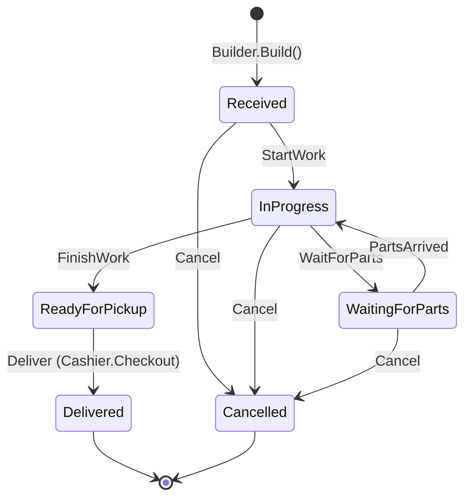
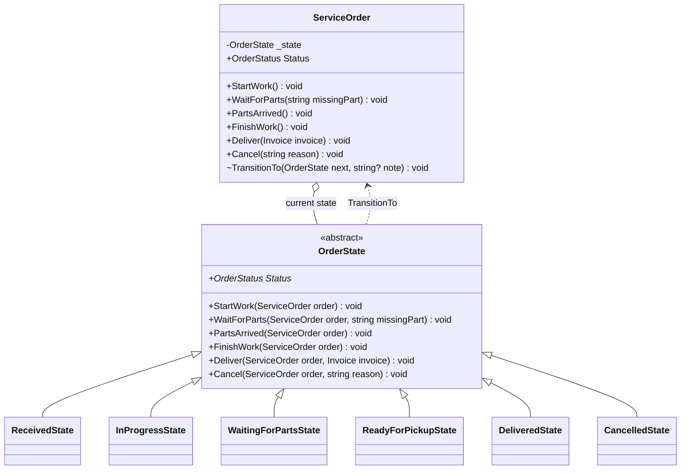
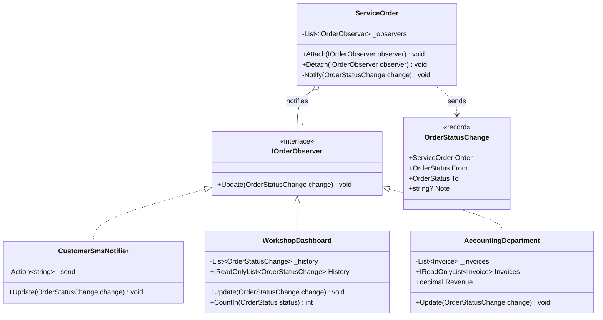
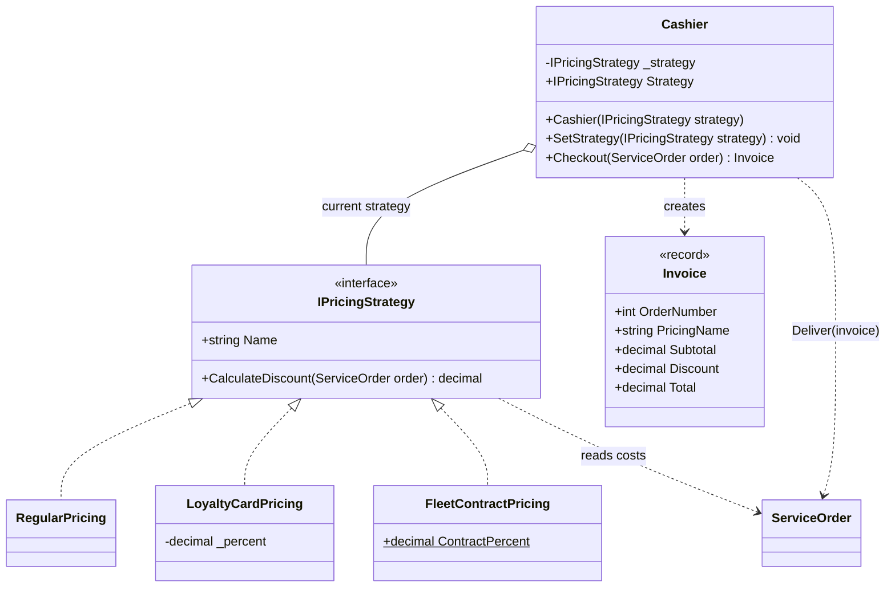
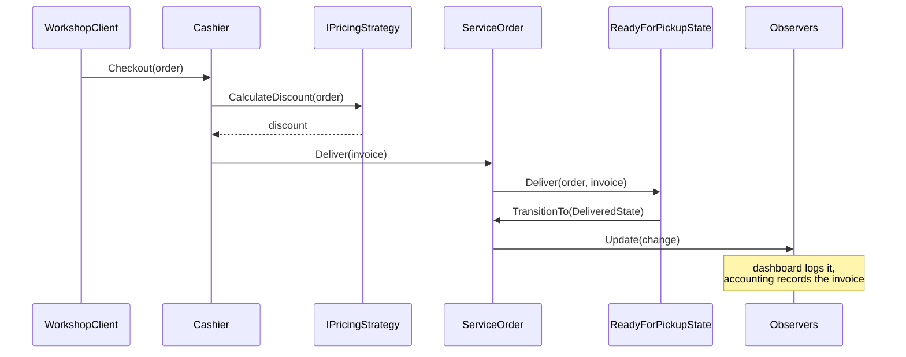

# Behavioral Design Patterns


## Author: Mihail Zastinceanu

----

## Objectives:

* Study and understand the Behavioral Design Patterns;
* As a continuation of the previous laboratory work, think about what communication between software entities might be involved in the system;
* Implement some additional functionalities using behavioral design patterns.


## Introduction / Theory / Motivation

Behavioral design patterns are about **communication and responsibilities between objects**: who does what, who tells whom that something happened, and how an algorithm or a behavior can be changed without rewriting the classes that use it. Creational patterns answer "how is an object created", behavioral patterns answer "how do objects work together after they are created".

The project continues the **car service center** from the previous laboratory work. In Lab 1 the workshop could only *create* orders (with Builder, Factory Method, Abstract Factory, Prototype, Singleton and Object Pool). In a real workshop an order then has to *move through the workshop*: a mechanic starts the work, sometimes the work stops because a part is missing, the car becomes ready, the customer pays and takes it, or the order is cancelled. Several parties must find out about these changes (the customer, the screen in the hall, the accounting department), and different customers pay in different ways (regular price, loyalty card, company fleet contract).

These three needs are solved with three behavioral patterns:

| Problem in the workshop | Pattern |
|---|---|
| What an order is allowed to do depends on where it is in its lifecycle | **State** |
| Several parties must react when an order changes its status | **Observer** |
| The final price is calculated differently for different customers | **Strategy** |

Language: **C# 12 / .NET 8**, console application, no frameworks or external libraries (xUnit is used only in the separate test project). There is only one client for the whole system: `WorkshopClient`.


## Project Structure

```
TMPS (branch lab-2)/
├── CarServiceBehavioral/
│   ├── Client/
│   │   └── WorkshopClient.cs            the only client of the system
│   ├── Domain/
│   │   ├── State/                       State           (Lab 2)
│   │   │   ├── OrderState.cs            abstract state
│   │   │   └── OrderStates.cs           6 concrete states
│   │   ├── Observer/                    Observer        (Lab 2)
│   │   │   ├── IOrderObserver.cs        observer interface + event data
│   │   │   └── OrderObservers.cs        SMS notifier, dashboard, accounting
│   │   ├── Strategy/                    Strategy        (Lab 2)
│   │   │   ├── IPricingStrategy.cs      strategy interface + 3 strategies
│   │   │   └── Cashier.cs               strategy context
│   │   ├── Models/
│   │   │   ├── ServiceOrder.cs          State context + Observer subject
│   │   │   ├── OrderStatus.cs
│   │   │   ├── Invoice.cs
│   │   │   └── ...                      Vehicle, services, parts, packages (Lab 1)
│   │   ├── Builder/                     Builder         (Lab 1)
│   │   ├── Factory/                     Abstract Factory, Factory Method (Lab 1)
│   │   ├── Pool/                        Object Pool     (Lab 1)
│   │   ├── Prototype/                   Prototype       (Lab 1)
│   │   └── Registry/                    Singleton       (Lab 1)
│   └── Program.cs
└── CarServiceBehavioral.Tests/
    ├── CreationalPatternsTests.cs       tests from Lab 1
    └── BehavioralPatternsTests.cs       tests for Lab 2
```


## Used Design Patterns: 

* State
* Observer
* Strategy

(plus the creational patterns from Lab 1, which are still used to create the orders: Singleton, Builder, Prototype, Factory Method, Abstract Factory, Object Pool)


## Implementation

### 1. State — `OrderState` and its subclasses

**Location:** `CarServiceBehavioral/Domain/State/OrderState.cs`, `CarServiceBehavioral/Domain/State/OrderStates.cs`, context in `CarServiceBehavioral/Domain/Models/ServiceOrder.cs`

**Main idea.** An order goes through the stages *Received → In Progress → (Waiting For Parts) → Ready For Pickup → Delivered*, and can be *Cancelled* before the work is finished. In every stage only some actions make sense: you cannot deliver a car that is still waiting for brake pads, you cannot start work on a cancelled order, and you cannot cancel a car that is already repaired. Without the pattern, every method of `ServiceOrder` would need a big `if`/`switch` over the status, and adding a new stage would mean changing all of them.

With State, every stage is a separate class. The base class `OrderState` forbids every action by default; each concrete state overrides only the actions that are allowed in it and decides which state comes next. `ServiceOrder` (the context) keeps a reference to its current state object and simply **delegates** every action to it. A new stage is a new class, and the rules of each stage are in one place.

```csharp
// Domain/State/OrderState.cs
public abstract class OrderState
{
    public abstract OrderStatus Status { get; }

    public virtual void StartWork(ServiceOrder order) => throw NotAllowed(order, "start the work");
    public virtual void FinishWork(ServiceOrder order) => throw NotAllowed(order, "finish the work");
    public virtual void Deliver(ServiceOrder order, Invoice invoice) => throw NotAllowed(order, "deliver the car");
    public virtual void Cancel(ServiceOrder order, string reason) => throw NotAllowed(order, "cancel the order");
    // ... WaitForParts, PartsArrived
}

// Domain/State/OrderStates.cs
public class InProgressState : OrderState
{
    public override OrderStatus Status => OrderStatus.InProgress;

    public override void WaitForParts(ServiceOrder order, string missingPart) =>
        order.TransitionTo(new WaitingForPartsState(), missingPart);

    public override void FinishWork(ServiceOrder order) => order.TransitionTo(new ReadyForPickupState());

    public override void Cancel(ServiceOrder order, string reason) => order.TransitionTo(new CancelledState(), reason);
}

// Domain/Models/ServiceOrder.cs  (the context only delegates)
private OrderState _state = new ReceivedState();

public OrderStatus Status => _state.Status;
public void StartWork() => _state.StartWork(this);
public void FinishWork() => _state.FinishWork(this);
public void Deliver(Invoice invoice) => _state.Deliver(this, invoice);
```

`TransitionTo` is `internal`, so only the state objects can change the state of an order; the client can only ask for an action.

State diagram of an order:



UML class diagram:



### 2. Observer — `IOrderObserver`

**Location:** `CarServiceBehavioral/Domain/Observer/IOrderObserver.cs`, `CarServiceBehavioral/Domain/Observer/OrderObservers.cs`, subject in `CarServiceBehavioral/Domain/Models/ServiceOrder.cs`

**Main idea.** When an order changes its status, several parts of the workshop must react: the customer gets an SMS, the screen in the hall shows the change, and accounting records the payment. If `ServiceOrder` called all of them directly, it would depend on every department, and adding a new one (for example e-mail notifications) would mean changing the order class.

With Observer, `ServiceOrder` is the **subject**: it only keeps a list of `IOrderObserver` objects and calls `Update` on each of them after every transition. It does not know what the observers do. Every observer decides by itself which changes it cares about: the SMS notifier reacts only to *Waiting For Parts*, *Ready For Pickup* and *Cancelled*, the dashboard logs everything, and accounting reacts only to *Delivered*. Observers can be attached and detached at runtime. The State and Observer patterns work together: the notification is sent from `TransitionTo`, which is called by the state objects.

```csharp
// Domain/Observer/IOrderObserver.cs
public interface IOrderObserver
{
    void Update(OrderStatusChange change);
}

public record OrderStatusChange(ServiceOrder Order, OrderStatus From, OrderStatus To, string? Note);

// Domain/Models/ServiceOrder.cs  (the subject)
public void Attach(IOrderObserver observer) { if (!_observers.Contains(observer)) _observers.Add(observer); }
public void Detach(IOrderObserver observer) => _observers.Remove(observer);

internal void TransitionTo(OrderState next, string? note = null)
{
    var from = _state.Status;
    _state = next;
    Notify(new OrderStatusChange(this, from, next.Status, note));
}

private void Notify(OrderStatusChange change)
{
    foreach (var observer in _observers.ToList())
        observer.Update(change);
}

// Domain/Observer/OrderObservers.cs  (one of the observers)
public class AccountingDepartment : IOrderObserver
{
    public void Update(OrderStatusChange change)
    {
        if (change.To == OrderStatus.Delivered && change.Order.Invoice is not null)
            _invoices.Add(change.Order.Invoice);
    }
}
```

The observers do not write to the console themselves: the SMS notifier and the dashboard receive an `Action<string>` from the client (the client passes `Console.WriteLine`, the tests pass a list), so the domain stays independent of the user interface.

UML class diagram:



### 3. Strategy — `IPricingStrategy` and `Cashier`

**Location:** `CarServiceBehavioral/Domain/Strategy/IPricingStrategy.cs`, `CarServiceBehavioral/Domain/Strategy/Cashier.cs`

**Main idea.** When the customer picks up the car, the cashier creates the invoice. How much the customer pays depends on who they are: a regular customer pays the full price, a loyalty card holder gets 10% off, and a company with a fleet contract does not pay the urgent fee and gets 5% off the rest. Writing all these rules as an `if`/`switch` inside the cashier would make the class grow with every new promotion.

With Strategy, every way of calculating the discount is a separate class that implements `IPricingStrategy`. The `Cashier` (the context) only asks its current strategy for the discount; it does not know how it is calculated. The strategy is chosen by the client and can be **changed at runtime** with `SetStrategy`, one customer after another. A new promotion is a new class, the cashier does not change. `Checkout` then calls `order.Deliver(invoice)`, so the State pattern still decides if the car can be delivered.

```csharp
// Domain/Strategy/IPricingStrategy.cs
public interface IPricingStrategy
{
    string Name { get; }
    decimal CalculateDiscount(ServiceOrder order);
}

public class FleetContractPricing : IPricingStrategy
{
    public const decimal ContractPercent = 5m;

    public string Name => $"Fleet contract (no urgent fee, -{ContractPercent}%)";
    public decimal CalculateDiscount(ServiceOrder order) => order.UrgentFee + order.BaseCost * ContractPercent / 100m;
}

// Domain/Strategy/Cashier.cs
public void SetStrategy(IPricingStrategy strategy) => _strategy = strategy;

public Invoice Checkout(ServiceOrder order)
{
    var subtotal = Math.Round(order.TotalCost, 2);
    var discount = Math.Round(_strategy.CalculateDiscount(order), 2);
    var invoice = new Invoice(order.Number, _strategy.Name, subtotal, discount);

    order.Deliver(invoice);     // the State decides if the car can be delivered
    return invoice;
}

// Client/WorkshopClient.cs
var cashier = new Cashier(new RegularPricing());
cashier.Checkout(loganOrder);
cashier.SetStrategy(new LoyaltyCardPricing());
cashier.Checkout(corollaOrder);
cashier.SetStrategy(new FleetContractPricing());
cashier.Checkout(focusOrder);
```

UML class diagram:



### How the patterns work together



### Other behavioral patterns (not implemented, short overview)

| Pattern | Idea | Example in this domain |
|---|---|---|
| Chain of Responsibility | A request is passed along a chain of handlers until one handles it | A discount request goes mechanic → shift manager → owner, depending on the amount |
| Command | A request is wrapped into an object, so it can be queued, logged or undone | "Replace brake pads" as a command in the mechanic's queue, with undo |
| Interpreter | A grammar for a small language and an interpreter for its sentences | Parsing promo rules like `total > 2000 AND loyal` |
| Iterator | Traverse a collection without exposing its internal structure | Iterating the orders of the registry by priority |
| Mediator | Objects communicate through a central object instead of directly | A reception desk that coordinates mechanics, bays and parts store |
| Memento | Save and restore an object's state without breaking encapsulation | Saving an order draft and restoring it after a wrong edit |
| Template Method | A base class defines the steps of an algorithm, subclasses fill some steps | `Inspect → Repair → Test drive`, with `Repair` different per service |
| Visitor | A new operation over a structure of objects without changing their classes | Calculating VAT or a warranty report over all services and parts |


## How to Run

Requires the .NET 8 SDK. From the repository root (branch `lab-2`):

```
dotnet run --project CarServiceBehavioral
dotnet test
```


## Conclusions / Screenshots / Results

Output of the program:

```
=== AutoFix Service Center ===

--- New orders ---
Order #1 Dacia Logan (C AB 123): Received, 730.00 MDL
Order #2 Toyota Corolla (K XY 777): Received, 2609.50 MDL
Order #3 Ford Focus (B CD 456): Received, 2460.00 MDL
Order #4 Skoda Octavia (O EF 789): Received, 400.00 MDL

--- Work in the workshop (State + Observer) ---
[dashboard] Order #1: Received -> InProgress
[dashboard] Order #2: Received -> InProgress
[dashboard] Order #3: Received -> InProgress
[dashboard] Order #2: InProgress -> WaitingForParts (OEM brake pads)
    SMS to Maria Rusu: we are waiting for a part (OEM brake pads), the repair will take longer.
    Deliver the Corolla now: refused - Order #2 is WaitingForParts: cannot deliver the car.
[dashboard] Order #1: InProgress -> ReadyForPickup
    SMS to Ion Popescu: your Dacia Logan is ready, you can pick it up.
[dashboard] Order #4: Received -> Cancelled (the customer changed their mind)
    SMS to Victor Lungu: order #4 was cancelled: the customer changed their mind.
    Start work on the cancelled Octavia: refused - Order #4 is Cancelled: cannot start the work.
[dashboard] Order #2: WaitingForParts -> InProgress
[dashboard] Order #2: InProgress -> ReadyForPickup
    SMS to Maria Rusu: your Toyota Corolla is ready, you can pick it up.
[dashboard] Order #3: InProgress -> ReadyForPickup
    SMS to FastTaxi SRL: your Ford Focus is ready, you can pick it up.
    Cancel the finished Focus: refused - Order #3 is ReadyForPickup: cannot cancel the order.
Free repair bays: 3/3

--- Checkout (Strategy) ---
[dashboard] Order #1: ReadyForPickup -> Delivered (paid 730.00 MDL)
    Invoice for order #1, pricing: Regular
      subtotal 730.00, discount 0.00, total 730.00 MDL
[dashboard] Order #2: ReadyForPickup -> Delivered (paid 2348.55 MDL)
    Invoice for order #2, pricing: Loyalty card (-10%)
      subtotal 2609.50, discount 260.95, total 2348.55 MDL
[dashboard] Order #3: ReadyForPickup -> Delivered (paid 1947.50 MDL)
    Invoice for order #3, pricing: Fleet contract (no urgent fee, -5%)
      subtotal 2460.00, discount 512.50, total 1947.50 MDL

--- Summary ---
Order #1 Dacia Logan (C AB 123): Delivered
Order #2 Toyota Corolla (K XY 777): Delivered
Order #3 Ford Focus (B CD 456): Delivered
Order #4 Skoda Octavia (O EF 789): Cancelled
Dashboard: 12 status changes, 3 delivered, 1 cancelled
Accounting: 3 invoices, revenue 5026.05 MDL
```

The Ford Focus is urgent: 2050.00 MDL + 20% urgent fee = 2460.00 MDL. With the fleet contract the urgent fee (410.00) is removed and 5% of 2050.00 (102.50) is taken off, so the company pays 1947.50 MDL.

All 31 unit tests pass (`dotnet test`): the 15 tests from Lab 1 and 16 new ones. The new tests check that an order follows its whole lifecycle, that forbidden actions (finishing before starting, delivering while waiting for parts, cancelling a finished or cancelled order) are rejected without changing the state, that observers receive every change, that the customer gets an SMS only for important changes, that a detached observer is not notified, that accounting records only delivered orders, and that every pricing strategy calculates the right discount and can be switched at runtime.

In this laboratory work I extended the car service center from the previous laboratory work with three behavioral design patterns that organize the communication between the objects. The **State** pattern moves the rules of each stage of an order into separate classes, so the order cannot do anything that is not allowed in its current stage and there are no long `switch` statements. The **Observer** pattern lets the customer, the dashboard and accounting react to the changes of an order without the order knowing anything about them, so new observers can be added without changing `ServiceOrder`. The **Strategy** pattern makes the pricing interchangeable: the cashier works with any pricing rule and the rule can be changed for each customer at runtime. The patterns are connected: the creational patterns from Lab 1 create the orders, the cashier (Strategy) delivers the car through the order's state (State), and every transition notifies the observers (Observer).
