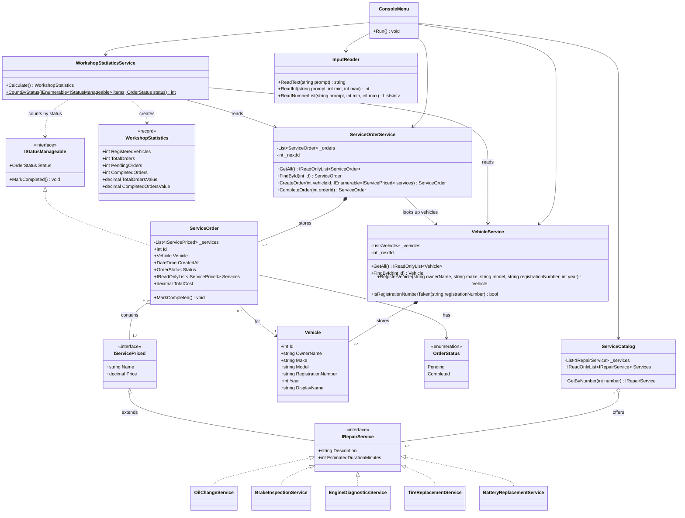

# Car Service Center Management System — SOLID Principles in C#

**Course:** TMPS (Software Design Techniques and Mechanisms), Technical University of Moldova (UTM)
**Laboratory topic:** SOLID design principles: SRP, OCP and ISP
**Language / platform:** C# 12, .NET 8 (LTS), console application

---

## Table of Contents

1. [Project Title](#1-project-title)
2. [Project Overview](#2-project-overview)
3. [Objectives](#3-objectives)
4. [Technologies Used](#4-technologies-used)
5. [Functional Requirements](#5-functional-requirements)
6. [Project Structure](#6-project-structure)
7. [Application Architecture](#7-application-architecture)
8. [SOLID Principles Implemented](#8-solid-principles-implemented)
9. [UML Class Diagram](#9-uml-class-diagram)
10. [How to Install and Run](#10-how-to-install-and-run)
11. [Example Application Session](#11-example-application-session)
12. [Testing and Verification](#12-testing-and-verification)
13. [Advantages and Limitations](#13-advantages-and-limitations)
14. [Possible Future Improvements](#14-possible-future-improvements)
15. [Conclusion](#15-conclusion)
16. [References](#16-references)

---

## 1. Project Title

**Car Service Center Management System — SOLID Principles in C#**

---

## 2. Project Overview

A car service center (auto repair workshop) has to keep track of the cars it services, the work ordered for each car, and how much that work costs. Small workshops often do this on paper or in spreadsheets, which leads to typing mistakes, duplicate records and wrong totals.

This project is a **console application** that simulates the basic operations of such a workshop:

- registering vehicles and their owners;
- showing the catalog of services the workshop offers;
- creating **service orders** that combine several services for one vehicle;
- calculating the cost of each order automatically, with a per-service breakdown;
- marking orders as completed;
- showing simple workshop statistics.

All data is kept **in memory** while the program runs. The main goal of the project is academic: to show, in real working code, how three SOLID principles (**SRP**, **OCP** and **ISP**) shape the design of a small but realistic application.

> **Note on prices:** all prices in the application (for example 850.00 MDL for an oil change) are **illustrative sample prices** chosen for the laboratory. They are not real workshop quotations.

---

## 3. Objectives

Learning objectives of this laboratory work:

1. Understand the theory behind the **Single Responsibility**, **Open/Closed** and **Interface Segregation** principles.
2. Apply these principles in the **architecture** of a working C# application, not only in theory.
3. Use **interfaces, polymorphism and encapsulation** in C#.
4. Separate the **user interface** from **business logic** and **data models**.
5. Show that new functionality (a new repair service) can be added by **extension** instead of modification.
6. Verify the design with **automated unit tests** and manual testing.
7. Document the design using a **UML class diagram**.

**Why SOLID matters.** Software changes all the time: prices change, new services appear, the UI might become a web page one day. Code that ignores SOLID tends to become a "big ball of mud", where a small change in one place breaks something elsewhere. SOLID principles are guidelines (originally popularized by Robert C. Martin) that keep classes small, focused and easy to extend, making the code easier to **read, test, change and reuse**.

---

## 4. Technologies Used

| Technology | Role in the project |
|---|---|
| **C# 12** | Programming language. Used for classes, interfaces, records, enums, properties, LINQ and nullable reference types. |
| **.NET 8 SDK (LTS)** | Platform and toolchain: `dotnet build`, `dotnet run`, `dotnet test`. Version 8 is a Long-Term Support release. |
| **Console interface** | Text-based interactive menu, run in the VS Code integrated terminal. No GUI, web server or database is needed. |
| **xUnit** | Unit testing framework used in the separate `CarServiceCenter.Tests` project. |
| **Mermaid** | Text-based diagram language. The UML class diagram is written in Mermaid inside Markdown, so GitHub (and VS Code with a Mermaid extension) renders it automatically. |
| **VS Code** | Editor and terminal used to develop and run the project. |

No external NuGet packages are used by the application itself. Only the test project references the standard xUnit test packages.

---

## 5. Functional Requirements

All features below are **implemented** and reachable from the main menu.

| # | Menu option | Implemented behaviour |
|---|---|---|
| 1 | Register a vehicle | Reads owner name, make, model, registration number and year. Generates a unique ID. Rejects empty fields, an invalid year (allowed range: 1950 to next year) and **duplicate registration numbers** (comparison ignores letter case and spaces, so `c ab 123` equals `CAB123`). |
| 2 | Display all registered vehicles | Table of all vehicles, or `No vehicles registered yet.` |
| 3 | Display available services | Catalog with name, sample price, estimated duration and description. |
| 4 | Create a service order | Select an existing vehicle by ID and **one or more services** (e.g. `1,2`). Duplicate numbers are ignored. Invalid vehicle IDs and empty or invalid selections are rejected. The total is calculated automatically. |
| 5 | Display all service orders | Table with ID, vehicle, number of services, total, status and creation date, or `No service orders yet.` |
| 6 | View order details and cost breakdown | Shows the vehicle, owner, status, date, each service with its price, and the total. |
| 7 | Mark an order as completed | Changes the status **Pending → Completed**. Completing an order twice is rejected. |
| 8 | Display workshop statistics | Registered vehicles, total, pending and completed orders, **total value of all orders** and **value of completed orders**, with an explicit note that these values are *not money received*. |
| 0 | Exit | Ends the program. The program also exits cleanly if the input stream ends. |

Five service types are available: **Oil and Filter Change**, **Brake Inspection**, **Engine Diagnostics**, **Tire Replacement** and **Battery Replacement**. The fifth one was added specifically to demonstrate the Open/Closed Principle (see section 8.2).

---

## 6. Project Structure

Actual directory tree (build output folders `bin/` and `obj/` are omitted):

```text
CarServiceCenter/                        <- open THIS folder in VS Code
├── CarServiceCenter.sln                 Solution file (app + tests)
├── README.md                            This laboratory report
├── UML_Class_Diagram.md                 UML class diagram + explanation
├── .gitignore                           Ignores bin/ and obj/
│
├── CarServiceCenter/                    The console application project
│   ├── CarServiceCenter.csproj          Project file (net8.0)
│   ├── Program.cs                       Entry point / composition root only
│   ├── Models/
│   │   ├── Vehicle.cs                   Vehicle data
│   │   ├── ServiceOrder.cs              Order data, total cost, status change
│   │   ├── OrderStatus.cs               enum: Pending, Completed
│   │   └── WorkshopStatistics.cs        record with the statistics numbers
│   ├── Interfaces/
│   │   ├── IServicePriced.cs            Pricing capability (Name, Price)
│   │   ├── IRepairService.cs            Catalog service (extends IServicePriced)
│   │   └── IStatusManageable.cs         Status capability (Status, MarkCompleted)
│   ├── Services/
│   │   ├── VehicleService.cs            Vehicle registration, validation, lookup
│   │   ├── ServiceOrderService.cs       Order creation, lookup, completion
│   │   ├── WorkshopStatisticsService.cs Statistics calculation
│   │   ├── ServiceCatalog.cs            List of offered repair services
│   │   └── RepairServices/
│   │       ├── OilChangeService.cs
│   │       ├── BrakeInspectionService.cs
│   │       ├── EngineDiagnosticsService.cs
│   │       ├── TireReplacementService.cs
│   │       └── BatteryReplacementService.cs
│   └── UI/
│       ├── ConsoleMenu.cs               Menu loop, printing, calls services
│       └── InputReader.cs               Reads and validates console input
│
└── CarServiceCenter.Tests/              xUnit test project
    ├── CarServiceCenter.Tests.csproj
    ├── VehicleServiceTests.cs
    ├── ServiceOrderServiceTests.cs
    ├── WorkshopStatisticsServiceTests.cs
    └── ServiceCatalogTests.cs
```

**Why two projects?** Tests are kept in a separate project so that test code and test packages are never compiled into the application. This is the standard .NET layout.

---

## 7. Application Architecture

The application is split into four simple layers. Each layer only talks to the layer below it.

```text
┌──────────────────────────────────────────────┐
│  Program.cs  (composition root)              │  creates and connects all objects
└──────────────────────┬───────────────────────┘
                       ▼
┌──────────────────────────────────────────────┐
│  UI:  ConsoleMenu  ──uses──►  InputReader    │  talks to the user (Console)
└──────────────────────┬───────────────────────┘
                       ▼
┌──────────────────────────────────────────────┐
│  Business services:                          │  rules and operations
│  VehicleService, ServiceOrderService,        │  (no Console calls here)
│  WorkshopStatisticsService, ServiceCatalog   │
│  + repair services (OilChangeService, ...)   │
└──────────────────────┬───────────────────────┘
                       ▼
┌──────────────────────────────────────────────┐
│  Models: Vehicle, ServiceOrder, OrderStatus, │  data
│  WorkshopStatistics                          │
│  Interfaces: IServicePriced, IRepairService, │  contracts / abstractions
│  IStatusManageable                           │
└──────────────────────────────────────────────┘
```

- **Models** hold data. `ServiceOrder` also contains the logic that belongs to the data itself: calculating its own total and changing its own status.
- **Interfaces** describe *capabilities* (being priced, being a catalog service, having a status). The rest of the code depends on these abstractions instead of concrete classes.
- **Business services** implement the workshop rules: unique registration numbers, valid years, "an order needs a vehicle and at least one service", "an order can be completed only once". They report problems by throwing `ArgumentException` or `InvalidOperationException` with a clear message. They never write to the console, so they can be tested automatically.
- **UI** (`ConsoleMenu` + `InputReader`) is the only place that uses `Console`. It reads input, calls a service, catches business errors and prints them as `Error: ...`.
- **`Program.cs`** only builds the objects and starts the menu.

**Validation is split in two levels:**

1. **Format validation** in `InputReader`: "is this a number?", "is it in range?", "is the field empty?". It asks again until the input is valid.
2. **Business validation** in the services: "does this registration number already exist?", "does vehicle 99 exist?", "is the order already completed?". The services check these rules even if the UI did not, which is why the unit tests can verify them directly.

**Typical flow: creating an order**

1. `ConsoleMenu.CreateOrder()` asks `InputReader` for a vehicle ID and service numbers.
2. It translates the numbers into `IRepairService` objects using `ServiceCatalog.GetByNumber()`.
3. It calls `ServiceOrderService.CreateOrder(vehicleId, services)`.
4. `ServiceOrderService` checks the vehicle exists (through `VehicleService`) and that the list is not empty, then creates a `ServiceOrder`.
5. `ServiceOrder.TotalCost` sums `service.Price` over all services (polymorphism).
6. `ConsoleMenu` prints the result.

---

## 8. SOLID Principles Implemented

### 8.1. S — Single Responsibility Principle (SRP)

**Full name:** Single Responsibility Principle.

**Theoretical definition:** *A class should have one, and only one, reason to change.* (Robert C. Martin)

**In simple words:** every class should do **one job**. If you can describe what a class does without using the word "and", it probably follows SRP. "Reason to change" means: which kind of requirement change (a new UI, a new validation rule, a new statistic) would force me to edit this class? Ideally only one kind.

**Why it is useful:**

- Small classes are easier to read and to explain.
- A change in one area (e.g. the console layout) cannot accidentally break another (e.g. price calculation).
- Business logic without `Console` calls can be **unit tested**.
- Classes can be reused, for example the same services behind a future web UI.

**Classes that demonstrate SRP and their single responsibility:**

| Class | Its one responsibility | It would change only if... |
|---|---|---|
| `Vehicle` | Hold vehicle data | the vehicle data changes (e.g. adding VIN) |
| `ServiceOrder` | Hold one order: its services, total and status | the order structure or status rules change |
| `VehicleService` | Register (with validation), find and list vehicles | vehicle business rules change |
| `ServiceOrderService` | Create, find, list and complete orders | order business rules change |
| `WorkshopStatisticsService` | Calculate statistics (read-only) | the required statistics change |
| `ServiceCatalog` | Keep the list of offered services | the way services are listed/selected changes |
| `InputReader` | Read and format-check console input | the input format rules change |
| `ConsoleMenu` | Show the menu, call the services, print results | the user interface changes |
| `Program` | Create and connect the objects | the set of objects changes |

**Code example** (from `Services/WorkshopStatisticsService.cs`):

```csharp
/// <summary>
/// Calculates workshop statistics. It only reads data; it never changes vehicles or orders.
/// </summary>
public class WorkshopStatisticsService
{
    private readonly VehicleService _vehicleService;
    private readonly ServiceOrderService _orderService;

    public WorkshopStatisticsService(VehicleService vehicleService, ServiceOrderService orderService)
    {
        _vehicleService = vehicleService;
        _orderService = orderService;
    }

    /// <summary>
    /// Builds a statistics snapshot from the current vehicles and orders.
    /// </summary>
    public WorkshopStatistics Calculate()
    {
        IReadOnlyList<ServiceOrder> orders = _orderService.GetAll();

        return new WorkshopStatistics(
            RegisteredVehicles: _vehicleService.GetAll().Count,
            TotalOrders: orders.Count,
            PendingOrders: CountByStatus(orders, OrderStatus.Pending),
            CompletedOrders: CountByStatus(orders, OrderStatus.Completed),
            TotalOrdersValue: orders.Sum(order => order.TotalCost),
            CompletedOrdersValue: orders
                .Where(order => order.Status == OrderStatus.Completed)
                .Sum(order => order.TotalCost));
    }
    // ... CountByStatus is shown in section 8.3
}
```

**Explanation:**

- The constructor receives the two services it needs to **read** data from. It does not create or store vehicles and orders itself; that is the job of `VehicleService` and `ServiceOrderService`.
- `Calculate()` only **computes numbers** and returns them in a `WorkshopStatistics` record.
- It does **not print** anything. Printing is done by `ConsoleMenu.ShowStatistics()`. If the teacher asks for the statistics in a different layout, only `ConsoleMenu` changes. If a new statistic is needed, only this class (and the record) changes.

The same idea is visible in `Program.cs`, which contains no logic and only builds the objects:

```csharp
var vehicleService = new VehicleService();
var orderService = new ServiceOrderService(vehicleService);
var statisticsService = new WorkshopStatisticsService(vehicleService, orderService);

var menu = new ConsoleMenu(new InputReader(), vehicleService, orderService, statisticsService, catalog);
menu.Run();
```

**What would be worse without SRP:** imagine a single `Workshop` class with methods like `ShowMenu()`, `ReadVehicleFromConsole()`, `CheckDuplicate()`, `CalculateTotal()`, `PrintStatistics()` and a list of vehicles and orders. Then:

- the class would grow to hundreds of lines and be hard to understand;
- changing the menu text could break price calculation, because everything shares the same fields;
- it would be impossible to unit test `CalculateTotal()` without simulating keyboard input;
- two students working on "new statistics" and "new menu" would edit the same file and get merge conflicts;
- moving to a web or GUI interface would mean rewriting everything.

**Conclusion:** every class in the project has one clearly named job. The UI, input reading, business rules, statistics and data are in separate classes. The proof is that all business classes are tested by 28 unit tests **without any console interaction**.

---

### 8.2. O — Open/Closed Principle (OCP)

**Full name:** Open/Closed Principle.

**Theoretical definition:** *Software entities (classes, modules, functions) should be open for extension, but closed for modification.* (Bertrand Meyer, 1988; popularized by Robert C. Martin)

**In simple words:** when a new requirement arrives, you should be able to **add new code** (a new class) instead of **editing existing, already-tested code**. In practice this is achieved with an **abstraction** (an interface) and **polymorphism**: the existing code talks to the interface, and new behaviour is added as a new implementation of that interface.

**Why it is useful:**

- Existing, tested code (order creation, total calculation) is not touched, so it cannot be broken by the new feature.
- New features are isolated in new files, which makes them easy to review.
- There is no long `switch` that grows with every new service.

**Files that demonstrate OCP:**

- Abstraction: `Interfaces/IRepairService.cs` (which extends `Interfaces/IServicePriced.cs`)
- Implementations: `Services/RepairServices/OilChangeService.cs`, `BrakeInspectionService.cs`, `EngineDiagnosticsService.cs`, `TireReplacementService.cs`, `BatteryReplacementService.cs`
- Code that is **closed for modification**: `Models/ServiceOrder.cs` (total calculation), `Services/ServiceOrderService.cs` (order creation), `Services/ServiceCatalog.cs` (service selection), `UI/ConsoleMenu.cs` (catalog display and breakdown)
- The single **registration point**: `Program.cs`

**The abstraction** (`Interfaces/IRepairService.cs`):

```csharp
public interface IRepairService : IServicePriced
{
    string Description { get; }
    int EstimatedDurationMinutes { get; }
}
```

with `IServicePriced` (`Interfaces/IServicePriced.cs`):

```csharp
public interface IServicePriced
{
    string Name { get; }
    decimal Price { get; }
}
```

**One implementation** (`Services/RepairServices/OilChangeService.cs`):

```csharp
public class OilChangeService : IRepairService
{
    public string Name => "Oil and Filter Change";
    public string Description => "Replace engine oil and oil filter";
    public decimal Price => 850.00m;
    public int EstimatedDurationMinutes => 45;
}
```

**Polymorphic price calculation** (`Models/ServiceOrder.cs`):

```csharp
public decimal TotalCost => _services.Sum(service => service.Price);
```

**Explanation:**

- `_services` is a `List<IServicePriced>`. The order does not know whether an element is an oil change or a battery replacement.
- `service.Price` is a **polymorphic call**: at runtime, C# calls the `Price` of the actual object (850.00 for `OilChangeService`, 300.00 for `BrakeInspectionService`, ...).
- `Sum(...)` adds them up. This single line works for **every** current and future service.

**Why a `switch` / `if-else` would be worse.** A non-OCP version could look like this (this is **not** in the project; it is the counter-example):

```csharp
// Counter-example (NOT used in the project)
decimal GetPrice(string serviceType)
{
    switch (serviceType)
    {
        case "OilChange":        return 850.00m;
        case "BrakeInspection":  return 300.00m;
        case "EngineDiagnostics":return 450.00m;
        case "TireReplacement":  return 600.00m;
        default: throw new ArgumentException("Unknown service");
    }
}
```

Problems with this approach:

1. **Every new service requires editing this method**, and usually other switches too (one for the name, one for the description, one for the duration, one for the menu).
2. It is easy to forget one of those switches, and the bug only appears at runtime (`Unknown service`).
3. Already-tested code has to be modified and re-tested every time.
4. All service knowledge is mixed in one place instead of each service describing itself.

> Note: `ConsoleMenu.HandleChoice()` does contain a `switch`, but over **menu options**, not over service types. Adding a new repair service never changes it.

**Step-by-step example: adding a new service.** `BatteryReplacementService` was added after the first four services exactly like this:

**Step 1.** Create a new class that implements the abstraction (`Services/RepairServices/BatteryReplacementService.cs`):

```csharp
public class BatteryReplacementService : IRepairService
{
    public string Name => "Battery Replacement";
    public string Description => "Remove old battery, fit and test new one (labour)";
    public decimal Price => 350.00m;
    public int EstimatedDurationMinutes => 20;
}
```

**Step 2.** Register it: add **one line** to the list in `Program.cs` (the composition root):

```csharp
var catalog = new ServiceCatalog(new List<IRepairService>
{
    new OilChangeService(),
    new BrakeInspectionService(),
    new EngineDiagnosticsService(),
    new TireReplacementService(),
    new BatteryReplacementService()
});
```

**Step 3.** Done. The new service automatically appears in the catalog (menu option 3), can be selected when creating an order, appears in the cost breakdown, and is included in totals and statistics.

**What changes and what stays the same:**

| File | Changed? | Why |
|---|---|---|
| `BatteryReplacementService.cs` | **New file** | The extension itself |
| `Program.cs` | **One line added** | Composition root: it decides which services the workshop offers |
| `IServicePriced.cs`, `IRepairService.cs` | No | The abstraction is stable |
| `ServiceOrder.cs` (`TotalCost`) | No | Works with any `IServicePriced` |
| `ServiceOrderService.cs` (`CreateOrder`) | No | Accepts any `IEnumerable<IServicePriced>` |
| `ServiceCatalog.cs` | No | Holds any `IRepairService` |
| `ConsoleMenu.cs` | No | Displays any `IRepairService` / `IServicePriced` |
| `WorkshopStatisticsService.cs` | No | Uses `order.TotalCost` |

**An honest note:** OCP does **not** mean that no existing file may ever change. Something has to tell the program that the new service exists. In this project that "something" is a single line in `Program.cs`, the composition root, whose only job is wiring objects together. The important point is that the **logic** (pricing, order creation, display, statistics) stays closed for modification.

**OCP proven by a unit test.** `ServiceOrderServiceTests.CreateOrder_NewServiceType_IsPricedWithoutChangingOrderCode` defines a service that exists **only inside the test project** (`WheelAlignmentService`, 275.50) and checks that the unchanged order code prices it correctly:

```csharp
var order = _orderService.CreateOrder(1, new IServicePriced[]
{
    new WheelAlignmentService(),
    new BatteryReplacementService() // 350.00
});

Assert.Equal(625.50m, order.TotalCost);
```

The test passes, so the application code is open for extension even from a different project.

**Conclusion:** price calculation, order creation and display depend only on `IServicePriced` / `IRepairService`. New services are added as new classes plus one registration line, with no `switch` on service types anywhere in the code.

---

### 8.3. I — Interface Segregation Principle (ISP)

**Full name:** Interface Segregation Principle.

**Theoretical definition:** *Clients should not be forced to depend on methods they do not use.* (Robert C. Martin)

**In simple words:** prefer several **small, focused interfaces** over one big "do-everything" interface. Each piece of code should see only the members it actually needs, and each class should implement only what makes sense for it.

**Why it is useful:**

- Classes do not need dummy methods or `throw new NotImplementedException()`.
- A change to one capability (e.g. status) does not affect code that only uses another (e.g. price).
- Code is easier to test and reuse, because a method that needs only a price can accept anything that has a price.

**Interfaces that demonstrate ISP and who uses them:**

| Interface | Members | Implemented by | Consumed by (the "client") |
|---|---|---|---|
| `IServicePriced` | `Name`, `Price` | all repair services (through `IRepairService`) | `ServiceOrder` (stores `List<IServicePriced>`, `TotalCost`), `ServiceOrderService.CreateOrder(...)`, cost breakdown in `ConsoleMenu.ShowOrderDetails()` |
| `IRepairService : IServicePriced` | adds `Description`, `EstimatedDurationMinutes` | `OilChangeService`, `BrakeInspectionService`, `EngineDiagnosticsService`, `TireReplacementService`, `BatteryReplacementService` | `ServiceCatalog`, `ConsoleMenu.ShowServiceCatalog()` (needs description and duration for the catalog) |
| `IStatusManageable` | `Status`, `MarkCompleted()` | `ServiceOrder` **only** | `WorkshopStatisticsService.CountByStatus(...)`. `ServiceOrderService.CompleteOrder()` also uses `MarkCompleted()`. |

**Code example 1.** The order only depends on the pricing capability (`Models/ServiceOrder.cs`):

```csharp
public class ServiceOrder : IStatusManageable
{
    private readonly List<IServicePriced> _services;
    // ...
    public IReadOnlyList<IServicePriced> Services => _services;
    // ...
    public decimal TotalCost => _services.Sum(service => service.Price);
```

- The order stores `IServicePriced`, not `IRepairService`. It needs only `Name` and `Price` to build the breakdown and total. It does not depend on `Description` or `EstimatedDurationMinutes`, which are catalog information.
- `ServiceOrder` itself implements `IStatusManageable`, because an order has a lifecycle (Pending → Completed).

**Code example 2.** A client that depends only on the status capability (`Services/WorkshopStatisticsService.cs`):

```csharp
/// <summary>
/// Counts items in a given status. It only needs the status capability, so it depends on IStatusManageable.
/// </summary>
public static int CountByStatus(IEnumerable<IStatusManageable> items, OrderStatus status)
{
    return items.Count(item => item.Status == status);
}
```

- `CountByStatus` does not care about vehicles, services or prices, so it asks only for `IStatusManageable`.
- Because `IEnumerable<T>` is covariant, a list of `ServiceOrder` can be passed directly: `CountByStatus(orders, OrderStatus.Pending)`.

**Code example 3.** The status interface and its single implementation (`Interfaces/IStatusManageable.cs`, `Models/ServiceOrder.cs`):

```csharp
public interface IStatusManageable
{
    OrderStatus Status { get; }
    void MarkCompleted();
}
```

```csharp
public void MarkCompleted()
{
    if (Status == OrderStatus.Completed)
    {
        throw new InvalidOperationException($"Order #{Id} is already completed.");
    }

    Status = OrderStatus.Completed;
}
```

**A realistic counter-example (what ISP prevents).** Suppose we had one large interface for "everything in the workshop":

```csharp
// Counter-example (NOT used in the project)
public interface IWorkshopItem
{
    string Name { get; }
    decimal Price { get; }
    string Description { get; }
    int EstimatedDurationMinutes { get; }
    OrderStatus Status { get; }
    void MarkCompleted();
}
```

Then:

- `OilChangeService` would be **forced** to implement `Status` and `MarkCompleted()`. But an oil change in the *catalog* is not "completed", only an *order* is. The only options would be a fake status or `throw new NotImplementedException()`, which crashes at runtime.
- `ServiceOrder` would be forced to implement `Description` and `EstimatedDurationMinutes` that it has no sensible value for.
- `CountByStatus` and `ServiceOrder.TotalCost` would depend on members they never use. Any change to the big interface would force all of them to recompile and possibly change.

**How the chosen design avoids this:**

- Pricing (`IServicePriced`), catalog information (`IRepairService`) and status management (`IStatusManageable`) are **separate capabilities**.
- Repair services implement only pricing and catalog information. They have **no** status members.
- Orders implement only status management. They have **no** description or duration.
- There are **no empty methods and no `NotImplementedException`** anywhere in the project.
- `IRepairService` extends `IServicePriced` instead of repeating `Name` and `Price`, so there is no duplication.

**Conclusion:** each interface is small (two members), has a clear purpose, at least one real implementer and at least one real consumer. No class is forced to implement members it does not need.

---

## 9. UML Class Diagram

The diagram below reflects the **final source code**. The same diagram, with a notation legend, is in [`UML_Class_Diagram.md`](UML_Class_Diagram.md). It was checked by rendering it with Mermaid 10.9.1 without errors.



**The most important relationships:**

1. **`IServicePriced <|-- IRepairService`**: interface inheritance. A catalog service *is* a priced item plus catalog details.
2. **Five `IRepairService <|.. ConcreteService` realizations**: the OCP extension point. A new service adds one more arrow here and changes nothing else in the diagram.
3. **`ServiceOrder "1" o-- "1..*" IServicePriced`**: an order aggregates **one or more** services and knows them only through the small pricing interface (OCP + ISP).
4. **`ServiceOrder "0..*" --> "1" Vehicle`**: every order belongs to exactly one vehicle, and a vehicle can have many orders.
5. **`IStatusManageable <|.. ServiceOrder`**: only orders have a status. Repair services do not (ISP).
6. **`VehicleService *-- Vehicle` and `ServiceOrderService *-- ServiceOrder`**: each service owns its in-memory collection.
7. **`ConsoleMenu --> ...services`**: the UI depends on the business layer, never the opposite (SRP).

---

## 10. How to Install and Run

### Prerequisites

- **.NET 8 SDK** (the project targets `net8.0`). The project was built and tested with **SDK 8.0.425**.
- **VS Code** (optionally with the *C# Dev Kit* extension for IntelliSense).

### Steps

1. In VS Code choose **File → Open Folder...** and open the folder that contains `CarServiceCenter.sln`:

   ```text
   D:\univer\tmps labs\CarServiceCenter
   ```

2. Open the integrated terminal (**Terminal → New Terminal**, or ``Ctrl+` ``). It opens in that folder. Run all commands below from there.

3. Check that the SDK is installed (the version must start with `8.` or higher):

   ```bash
   dotnet --version
   ```

   If you see "No .NET SDKs were found", install the .NET 8 SDK, for example with `winget install Microsoft.DotNet.SDK.8`, then reopen the terminal.

4. Restore packages (needed once, for the test project):

   ```bash
   dotnet restore
   ```

5. Build the application and tests:

   ```bash
   dotnet build
   ```

   Expected end of output: `Build succeeded.  0 Warning(s)  0 Error(s)`.

6. Run the application:

   ```bash
   dotnet run --project CarServiceCenter
   ```

   (Alternatively: `cd CarServiceCenter`, then `dotnet run`.)

7. Run the unit tests:

   ```bash
   dotnet test
   ```

   Expected: `Passed!  - Failed: 0, Passed: 28, Skipped: 0, Total: 28`.

---

## 11. Example Application Session

Below is a real session (date and time will differ on your machine). The **user's input is shown after each prompt**. The main menu is printed after every action; it is shown in full once and abbreviated as `[main menu]` afterwards.

**Start and register a vehicle**

```text
=== Car Service Center Management System ===

Main menu
  1. Register a vehicle
  2. Display all registered vehicles
  3. Display available services (sample prices)
  4. Create a service order
  5. Display all service orders
  6. View order details and cost breakdown
  7. Mark an order as completed
  8. Display workshop statistics
  0. Exit
Choose an option: 1

--- Register a vehicle ---
Owner name: Ion Popescu
Make: Dacia
Model: Logan
Registration number: C AB 123
Manufacturing year (1950-2027): 20x8
  Invalid input. Please enter a whole number between 1950 and 2027.
Manufacturing year (1950-2027): 2018
Vehicle registered successfully with ID 1.
```

**Duplicate registration number (different case) is rejected, then a second vehicle is registered**

```text
[main menu]
Choose an option: 1

--- Register a vehicle ---
Owner name: Maria Rusu
Make: Toyota
Model: Corolla
Registration number: c ab 123
Manufacturing year (1950-2027): 2021
Error: A vehicle with registration number 'C AB 123' is already registered.

[main menu]
Choose an option: 1

--- Register a vehicle ---
Owner name: Maria Rusu
Make: Toyota
Model: Corolla
Registration number: K XY 777
Manufacturing year (1950-2027): 2021
Vehicle registered successfully with ID 2.

[main menu]
Choose an option: 2

ID  Owner               Vehicle               Reg. number   Year
------------------------------------------------------------
1   Ion Popescu         Dacia Logan           C AB 123      2018
2   Maria Rusu          Toyota Corolla        K XY 777      2021
```

**Create a service order with two services (with invalid selections first)**

```text
[main menu]
Choose an option: 4

--- Create a service order ---
ID  Owner               Vehicle               Reg. number   Year
------------------------------------------------------------
1   Ion Popescu         Dacia Logan           C AB 123      2018
2   Maria Rusu          Toyota Corolla        K XY 777      2021

Vehicle ID: 1

Available services (sample prices, not real quotations):
No  Service                          Price     Time  Description
------------------------------------------------------------
1   Oil and Filter Change       850.00 MDL   45 min  Replace engine oil and oil filter
2   Brake Inspection            300.00 MDL   30 min  Check pads, discs and brake fluid
3   Engine Diagnostics          450.00 MDL   60 min  Computer scan of engine error codes
4   Tire Replacement            600.00 MDL   60 min  Mount and balance a set of 4 tires (labour)
5   Battery Replacement         350.00 MDL   20 min  Remove old battery, fit and test new one (labour)

Service numbers, separated by commas (e.g. 1,3):
  Invalid selection. Enter at least one number between 1 and 5, separated by commas.
Service numbers, separated by commas (e.g. 1,3): 1,9
  Invalid selection. Enter at least one number between 1 and 5, separated by commas.
Service numbers, separated by commas (e.g. 1,3): 1, 2, 2
Service order #1 created with 2 service(s). Total: 1,150.00 MDL
```

(The duplicate `2` was ignored, so the order contains two services: 850.00 + 300.00 = 1,150.00.)

**Invalid vehicle ID**

```text
[main menu]
Choose an option: 4

--- Create a service order ---
(vehicle table)
Vehicle ID: 99
Error: Vehicle with ID 99 was not found.
```

**A second order (Engine Diagnostics + Battery Replacement) and the list of orders**

```text
[main menu]
Choose an option: 4
...
Vehicle ID: 2
...
Service numbers, separated by commas (e.g. 1,3): 3,5
Service order #2 created with 2 service(s). Total: 800.00 MDL

[main menu]
Choose an option: 5

ID  Vehicle                      Services           Total  Status    Created
------------------------------------------------------------
1   Dacia Logan (C AB 123)              2    1,150.00 MDL  Pending   2026-10-13 14:38
2   Toyota Corolla (K XY 777)           2      800.00 MDL  Pending   2026-10-13 14:38
```

**View an order with its cost breakdown**

```text
[main menu]
Choose an option: 6

Order ID: 1

Service order #1
Status:  Pending
Created: 2026-10-13 14:38
Vehicle: #1 Dacia Logan (C AB 123), 2018
Owner:   Ion Popescu
Cost breakdown (sample prices):
------------------------------------------------------------
  1. Oil and Filter Change                        850.00 MDL
  2. Brake Inspection                             300.00 MDL
------------------------------------------------------------
     TOTAL                                      1,150.00 MDL
```

**Complete an order (and try to complete it again)**

```text
[main menu]
Choose an option: 7

Order ID to mark as completed: 1
Order #1 is now Completed.

[main menu]
Choose an option: 7

Order ID to mark as completed: 1
Error: Order #1 is already completed.
```

**Workshop statistics and exit**

```text
[main menu]
Choose an option: 8

Workshop statistics
------------------------------------------------------------
Registered vehicles:            2
Total service orders:           2
Pending orders:                 1
Completed orders:               1
Total value of all orders:      1,950.00 MDL
Value of completed orders:      1,150.00 MDL
Note: order values are not money received. Payments are not tracked in this version.

[main menu]
Choose an option: 0

Goodbye!
```

---

## 12. Testing and Verification

Two kinds of testing were performed: **automated unit tests** (xUnit) and **manual end-to-end runs** of the real console application. All results below come from actual executions.

### 12.1. Automated unit tests

Command: `dotnet test` (from the solution folder).

**Actual result:**

```text
Passed!  - Failed:     0, Passed:    28, Skipped:     0, Total:    28, Duration: 25 ms - CarServiceCenter.Tests.dll (net8.0)
```

| Test class | Test | Scenario | Result |
|---|---|---|---|
| `VehicleServiceTests` | `RegisterVehicle_ValidData_AssignsUniqueIds` | Valid registration; IDs 1 and 2 are generated | Passed |
| | `RegisterVehicle_NormalizesRegistrationNumber` | `"  c   ab 123 "` is stored as `"C AB 123"` | Passed |
| | `RegisterVehicle_DuplicateRegistrationNumber_Throws` (3 cases) | `C AB 123`, `c ab 123`, `CAB123` are all rejected as duplicates | Passed ×3 |
| | `RegisterVehicle_MissingRequiredField_Throws` (4 cases) | Empty owner / make / model / registration number | Passed ×4 |
| | `RegisterVehicle_YearOutOfRange_Throws` (2 cases) | Years 1900 and 3000 | Passed ×2 |
| | `GetAll_NoVehicles_ReturnsEmptyList` | Empty vehicle list | Passed |
| | `FindById_UnknownId_ReturnsNull` | Unknown vehicle ID | Passed |
| `ServiceOrderServiceTests` | `CreateOrder_MultipleServices_CalculatesCorrectTotal` | 850 + 300 + 450 = **1600.00** | Passed |
| | `CreateOrder_NewOrder_IsPendingAndLinkedToVehicle` | New order is `Pending`, linked to the right vehicle | Passed |
| | `CreateOrder_InvalidVehicleId_Throws` | Vehicle ID 99 does not exist | Passed |
| | `CreateOrder_NoServices_Throws` | Empty service selection | Passed |
| | `CompleteOrder_PendingOrder_BecomesCompleted` | Pending → Completed | Passed |
| | `CompleteOrder_AlreadyCompleted_Throws` | Completing twice is rejected | Passed |
| | `CompleteOrder_UnknownOrder_Throws` | Unknown order ID | Passed |
| | `GetAll_NoOrders_ReturnsEmptyList` | Empty order list | Passed |
| | `CreateOrder_NewServiceType_IsPricedWithoutChangingOrderCode` | **OCP:** a test-only service (275.50) + battery (350.00) = **625.50** | Passed |
| `WorkshopStatisticsServiceTests` | `Calculate_NoData_ReturnsZeros` | Statistics with no data | Passed |
| | `Calculate_WithOrders_CountsStatusesAndValues` | 2 vehicles, 2 orders, 1 pending, 1 completed, total 1600.00, completed 1150.00 | Passed |
| `ServiceCatalogTests` | `GetByNumber_ValidNumber_ReturnsService` | Number 2 → "Brake Inspection" | Passed |
| | `GetByNumber_InvalidNumber_ReturnsNull` (3 cases) | Numbers 0, 3, -1 | Passed ×3 |

### 12.2. Manual end-to-end tests of the console application

The real application was started with `dotnet run --project CarServiceCenter` and driven with scripted input. The output was inspected (the session in section 11 is taken from this run).

| # | Scenario | Input | Observed result | Status |
|---|---|---|---|---|
| 1 | Empty vehicle list | option 2 | `No vehicles registered yet.` | OK |
| 2 | Empty order list | options 5, 6, 7 | `No service orders yet.` | OK |
| 3 | Statistics with no data | option 8 | all counters 0, values `0.00 MDL` | OK |
| 4 | Create order without vehicles | option 4 | `No vehicles registered yet. Please register a vehicle first.` | OK |
| 5 | Invalid numeric menu input | `abc`, `9` | `Invalid input. Please enter a whole number between 0 and 8.` | OK |
| 6 | Empty required text | empty line, spaces | `This field is required. Please enter a value.` | OK |
| 7 | Invalid year | `20x8` | re-prompt with range message | OK |
| 8 | Valid vehicle registration | Ion Popescu, Dacia Logan, `C AB 123`, 2018 | `Vehicle registered successfully with ID 1.` | OK |
| 9 | Duplicate registration number | `c ab 123` | `Error: A vehicle with registration number 'C AB 123' is already registered.` | OK |
| 10 | Invalid vehicle ID in order | `99` | `Error: Vehicle with ID 99 was not found.` | OK |
| 11 | Empty / out-of-range service selection | empty, `1,9` | `Invalid selection...` re-prompt | OK |
| 12 | Order with multiple services | `1, 2, 2` | 2 services, total `1,150.00 MDL` | OK |
| 13 | Second order | vehicle 2, `3,5` | total `800.00 MDL` (450 + 350) | OK |
| 14 | Order details / breakdown | option 6, ID 1 | lines 850.00 and 300.00, TOTAL 1,150.00 | OK |
| 15 | Unknown order ID | option 6, ID 5 | `Error: Order with ID 5 was not found.` | OK |
| 16 | Pending → Completed | option 7, ID 1 | `Order #1 is now Completed.` | OK |
| 17 | Complete twice | option 7, ID 1 | `Error: Order #1 is already completed.` | OK |
| 18 | Workshop statistics | option 8 | 2 vehicles, 2 orders, 1 pending, 1 completed, 1,950.00 total, 1,150.00 completed | OK |
| 19 | Exit | option 0 | `Goodbye!`, exit code 0 | OK |
| 20 | Input stream ends unexpectedly | no more input | `Input ended.` `Goodbye!` (no crash) | OK |

### 12.3. Other verification

- `dotnet build`: **Build succeeded, 0 warnings, 0 errors** (nullable reference types enabled).
- The Mermaid diagram was rendered with Mermaid 10.9.1 without syntax errors, and every class, interface and member in it was compared with the source code.
- All code snippets in section 8 were copied from the final source files.

---

## 13. Advantages and Limitations

### Advantages

- **Clear separation of concerns (SRP):** UI, input validation, business rules, statistics and data are in different classes.
- **Easy to extend (OCP):** a new repair service is one new class plus one line in `Program.cs`.
- **No fat interfaces (ISP):** three two-member interfaces, each with real implementers and consumers, and no `NotImplementedException`.
- **Testable:** business classes have no `Console` dependency and are covered by 28 unit tests.
- **Robust input handling:** invalid numbers, empty fields, duplicates, unknown IDs and end of input are all handled without crashes.
- **Beginner-friendly:** no frameworks, no dependency injection container, no database. Plain C# classes and interfaces.

### Limitations

- **In-memory data only:** all vehicles and orders are lost when the program exits.
- **No payments:** the application tracks the *value* of orders, not money actually received. This is stated explicitly in the statistics.
- **Fixed sample prices:** prices are hard-coded in each service class and are illustrative only. Changing a price requires recompiling.
- **Orders cannot be edited or deleted** after creation (only completed).
- **Vehicles cannot be edited or deleted.**
- **Only two statuses** (Pending, Completed). There is no "In progress" or "Cancelled".
- **Single user, single session:** no authentication and no concurrent access.
- Prices are read live from the service objects; if a price were changed in code, older orders would show the new price (no price "snapshot" per order).

---

## 14. Possible Future Improvements

> These are **ideas only**. None of them is implemented in the current version.

- **Persistent storage:** save data to a JSON file or a database (e.g. SQLite with Entity Framework Core) behind a repository interface.
- **Customer invoices and payments:** record payments per order and show "paid" vs "unpaid" amounts.
- **Spare-parts inventory:** track parts used by each service and their stock.
- **Appointment scheduling:** book a date and time slot using `EstimatedDurationMinutes`.
- **More statuses:** In progress, Cancelled, Waiting for parts.
- **Editable price list:** load services and prices from a configuration file.
- **Discounts and taxes:** for example a loyalty discount, implemented as new pricing rules without changing existing ones (another OCP extension point).
- **Graphical or web interface:** reuse the same business services with a WPF, MAUI or ASP.NET Core front end. Only the UI layer would be replaced.

---

## 15. Conclusion

This laboratory work produced a working Car Service Center Management System in C# that demonstrates three SOLID principles in its real architecture:

- **SRP:** each class has one job. `ConsoleMenu` talks to the user, `InputReader` validates input format, `VehicleService` and `ServiceOrderService` apply business rules, `WorkshopStatisticsService` computes statistics, and the models hold data. As a result, the business logic could be unit tested without any console interaction.
- **OCP:** price calculation (`ServiceOrder.TotalCost`) and order creation work with the `IServicePriced` / `IRepairService` abstractions. `BatteryReplacementService` was added without modifying any pricing or order logic, and a unit test proved that even a service defined in another project is priced correctly.
- **ISP:** pricing, catalog information and status management are separate small interfaces. Repair services are not forced to have a status, and orders are not forced to have a description.

The main lessons learned are: designing around **abstractions** makes extension cheap; **small focused classes and interfaces** are easier to understand, test and explain; and SOLID is about managing **change**, not about creating as many files as possible. Every interface and class in this project exists because it has a clear role.

---

## 16. References

1. Microsoft. *C# documentation.* <https://learn.microsoft.com/en-us/dotnet/csharp/>
2. Microsoft. *Interfaces: define behavior for multiple types (C#).* <https://learn.microsoft.com/en-us/dotnet/csharp/fundamentals/types/interfaces>
3. Microsoft. *Polymorphism (C# Programming Guide).* <https://learn.microsoft.com/en-us/dotnet/csharp/fundamentals/object-oriented/polymorphism>
4. Microsoft. *Architectural principles* (includes Single Responsibility and related principles). <https://learn.microsoft.com/en-us/dotnet/architecture/modern-web-apps-azure/architectural-principles>
5. Microsoft. *.NET CLI overview.* <https://learn.microsoft.com/en-us/dotnet/core/tools/>
6. Microsoft. *Unit testing C# with xUnit and .NET.* <https://learn.microsoft.com/en-us/dotnet/core/testing/unit-testing-with-dotnet-test>
7. xUnit.net. *Official website and documentation.* <https://xunit.net/>
8. Mermaid. *Class diagrams syntax.* <https://mermaid.js.org/syntax/classDiagram.html>
9. Robert C. Martin. *Agile Software Development, Principles, Patterns, and Practices.* Prentice Hall, 2002.
10. Robert C. Martin. *Clean Architecture: A Craftsman's Guide to Software Structure and Design.* Prentice Hall, 2017.
11. Bertrand Meyer. *Object-Oriented Software Construction.* Prentice Hall, 1988 (origin of the Open/Closed Principle).
