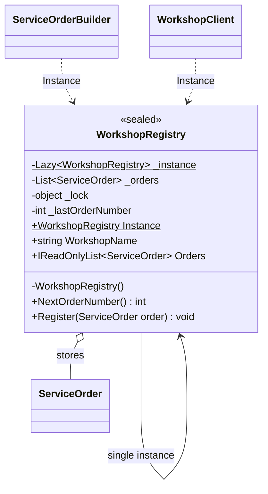
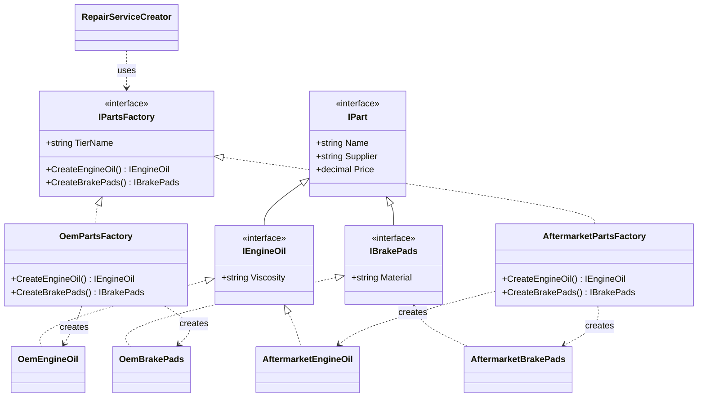
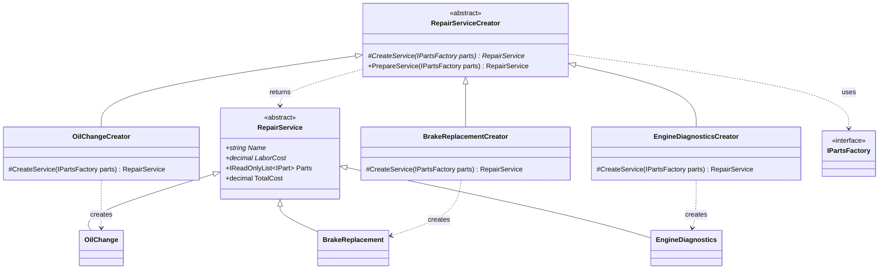
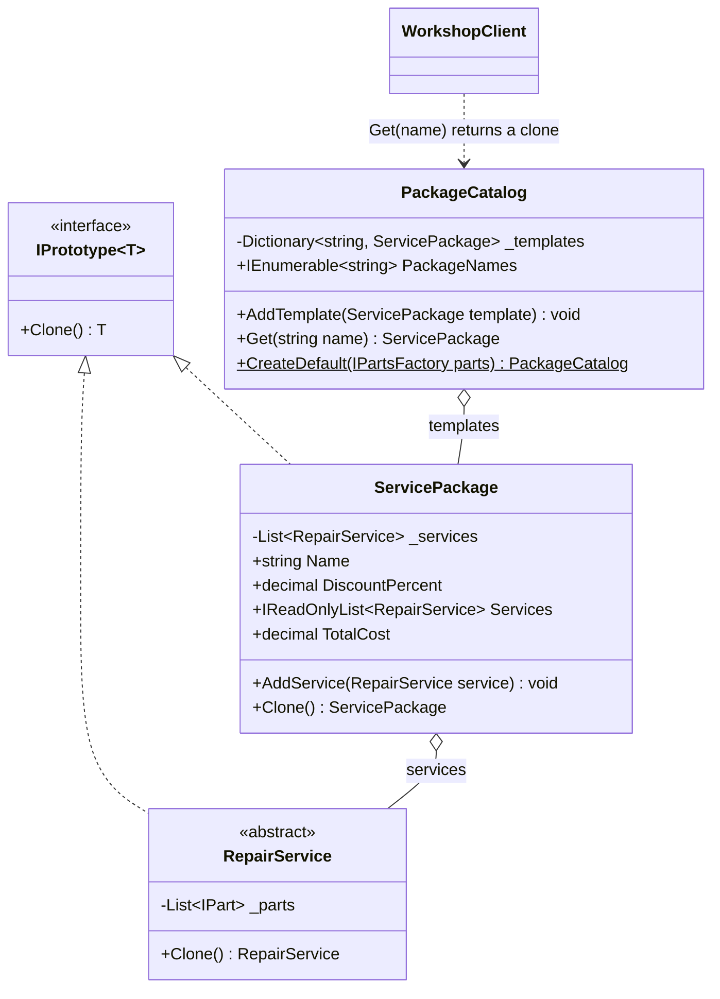
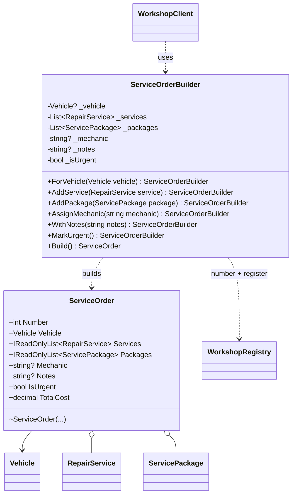
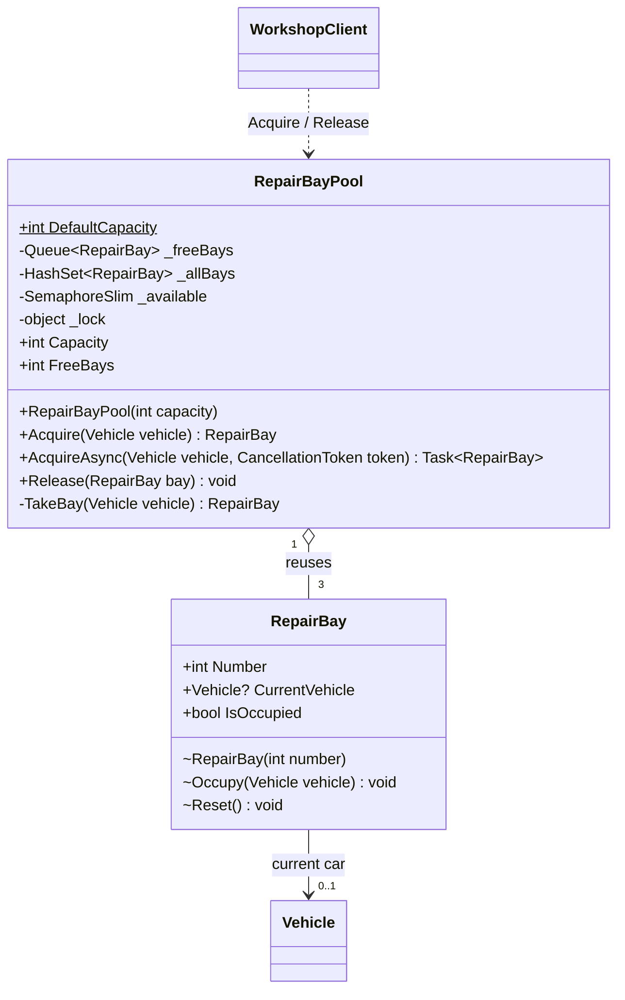

# Creational Design Patterns


## Author: Mihail Zastinceanu

----

## Objectives:

* Get familiar with the Creational DPs;
* Choose a specific domain;
* Implement at least 3 CDPs for the specific domain;


## Domain

The domain is a **car service center** (auto repair workshop), the same domain as in the previous laboratory work. The workshop registers vehicles, offers repair services (oil change, brake pads replacement, engine diagnostics) that use spare parts of different quality tiers, sells discounted service packages and creates work orders for customers.

Main entities: `Vehicle`, `RepairService` (`OilChange`, `BrakeReplacement`, `EngineDiagnostics`), spare parts (`IEngineOil`, `IBrakePads`), `ServicePackage` and `ServiceOrder`.

Language: **C# 12 / .NET 8**, console application, no frameworks or external libraries (xUnit is used only in the separate test project).


## Project Structure

```
TMPS (branch lab-1)/
├── CarServiceCreational/
│   ├── Client/
│   │   └── WorkshopClient.cs            client code that uses the patterns
│   ├── Domain/
│   │   ├── Builder/
│   │   │   └── ServiceOrderBuilder.cs   Builder
│   │   ├── Factory/
│   │   │   ├── PartsFactories/          Abstract Factory
│   │   │   └── ServiceCreators/         Factory Method
│   │   ├── Models/
│   │   │   ├── Parts/                   products of the Abstract Factory
│   │   │   ├── Services/                products of the Factory Method
│   │   │   ├── Vehicle.cs
│   │   │   ├── ServicePackage.cs        Prototype
│   │   │   ├── ServiceOrder.cs          product of the Builder
│   │   │   └── RepairBay.cs             object reused by the Object Pool
│   │   ├── Pool/
│   │   │   └── RepairBayPool.cs         Object Pool
│   │   ├── Prototype/
│   │   │   ├── IPrototype.cs
│   │   │   └── PackageCatalog.cs        prototype registry
│   │   └── Registry/
│   │       └── WorkshopRegistry.cs      Singleton
│   └── Program.cs
└── CarServiceCreational.Tests/          xUnit tests
```


## Used Design Patterns: 

* Singleton
* Builder
* Prototype
* Factory Method
* Abstract Factory
* Object Pool


## Implementation

### 1. Singleton — `WorkshopRegistry`

The workshop must have only one registry of orders, otherwise two parts of the program could give the same number to two different orders. The constructor is private and the only instance is created lazily through `Lazy<T>`, which is thread-safe. The registry gives out order numbers and stores all created orders.

```csharp
public sealed class WorkshopRegistry
{
    private static readonly Lazy<WorkshopRegistry> _instance = new(() => new WorkshopRegistry());

    private WorkshopRegistry() { }

    public static WorkshopRegistry Instance => _instance.Value;

    public int NextOrderNumber()
    {
        lock (_lock) return ++_lastOrderNumber;
    }
}
```

UML class diagram:



### 2. Abstract Factory — `IPartsFactory`

A customer can choose original (OEM) parts or cheaper aftermarket parts. All parts used for one car should come from the same tier. `IPartsFactory` creates a family of related products (engine oil and brake pads), and each concrete factory (`OemPartsFactory`, `AftermarketPartsFactory`) creates only parts of its own tier. The client code works only with the interfaces `IEngineOil` and `IBrakePads`.

```csharp
public interface IPartsFactory
{
    string TierName { get; }
    IEngineOil CreateEngineOil();
    IBrakePads CreateBrakePads();
}

public class OemPartsFactory : IPartsFactory
{
    public string TierName => "OEM";
    public IEngineOil CreateEngineOil() => new OemEngineOil();
    public IBrakePads CreateBrakePads() => new OemBrakePads();
}
```

UML class diagram:



### 3. Factory Method — `RepairServiceCreator`

`RepairServiceCreator` has the common logic for preparing a service (it validates the cost) in `PrepareService`, but it does not know which concrete service to create. Each subclass overrides the factory method `CreateService` and decides what object to create. To add a new service type, a new creator is added without changing the existing code. The creators use the Abstract Factory to get the parts.

```csharp
public abstract class RepairServiceCreator
{
    protected abstract RepairService CreateService(IPartsFactory parts);

    public RepairService PrepareService(IPartsFactory parts)
    {
        var service = CreateService(parts);
        if (service.TotalCost <= 0)
            throw new InvalidOperationException($"Service '{service.Name}' has an invalid cost.");
        return service;
    }
}

public class OilChangeCreator : RepairServiceCreator
{
    protected override RepairService CreateService(IPartsFactory parts) => new OilChange(parts.CreateEngineOil());
}
```

UML class diagram:



### 4. Prototype — `ServicePackage` and `PackageCatalog`

The workshop sells ready-made packages ("Basic Maintenance", "Full Check"). Instead of creating every package from zero, `PackageCatalog` keeps templates and returns **clones** of them. A clone can be customized (renamed, a service added) without affecting the template. `Clone()` is a deep copy: the list of services is cloned too, so the copy and the template do not share mutable data.

```csharp
public ServicePackage Clone()
{
    var copy = (ServicePackage)MemberwiseClone();
    copy._services = _services.Select(s => s.Clone()).ToList();
    return copy;
}

public ServicePackage Get(string name)
{
    if (!_templates.TryGetValue(name, out var template))
        throw new KeyNotFoundException($"Package '{name}' does not exist.");
    return template.Clone();
}
```

UML class diagram:



### 5. Builder — `ServiceOrderBuilder`

A `ServiceOrder` has one required field (the vehicle) and many optional ones: services, packages, mechanic, notes, urgency. A constructor with seven parameters would be hard to read, so the order is built step by step with a fluent builder. `Build()` checks that the order is valid, takes a number from the Singleton and registers the order. The `ServiceOrder` constructor is `internal`, so orders can be created only through the builder.

```csharp
var order = new ServiceOrderBuilder()
    .ForVehicle(corolla)
    .AddPackage(catalog.Get("Full Check"))
    .WithNotes("Noise from the front wheels")
    .MarkUrgent()
    .Build();
```

UML class diagram:



### 6. Object Pool — `RepairBayPool`

The service center has only **3 repair bays**. A bay is not created for every car: the same 3 `RepairBay` objects are reused. A car takes (`Acquire`) a free bay and gives it back (`Release`) when the repair is done; the bay is reset so the next car gets it clean. If all 3 bays are occupied, the next car **waits** until a bay is released. The waiting is done with a `SemaphoreSlim` that counts the free bays, so the pool is also thread-safe. `Release` checks that the bay belongs to this pool and is not already free. The `RepairBay` constructor is `internal`, so bays are created only by the pool.

```csharp
public RepairBay Acquire(Vehicle vehicle)
{
    _available.Wait();          // waits while all bays are occupied
    return TakeBay(vehicle);
}

public void Release(RepairBay bay)
{
    lock (_lock)
    {
        if (!_allBays.Contains(bay))
            throw new InvalidOperationException($"Bay {bay.Number} does not belong to this workshop.");
        if (!bay.IsOccupied)
            throw new InvalidOperationException($"Bay {bay.Number} is already free.");

        bay.Reset();
        _freeBays.Enqueue(bay);
    }
    _available.Release();       // wakes up the next waiting car
}
```

Usage:

```csharp
var bays = new RepairBayPool();                 // 3 bays
var loganBay = bays.Acquire(logan);             // bay 1
bays.Acquire(corolla);                          // bay 2
bays.Acquire(focus);                            // bay 3
var waiting = bays.AcquireAsync(octavia);       // all bays busy -> the car waits
bays.Release(loganBay);                         // bay 1 is free again
var octaviaBay = await waiting;                 // Octavia gets bay 1
```

UML class diagram:




## How to Run

Requires the .NET 8 SDK. From the repository root (branch `lab-1`):

```
dotnet run --project CarServiceCreational
dotnet test
```


## Conclusions / Screenshots / Results

Output of the program:

```
=== AutoFix Service Center ===
Singleton: same instance every time = True

--- Abstract Factory + Factory Method ---
Oil Change with OEM Engine Oil 5W-30: 1020.00 MDL
Oil Change with Aftermarket Engine Oil 10W-40: 730.00 MDL

--- Prototype ---
Template:   Basic Maintenance, 2 services, 1278.00 MDL
Customized: Basic Maintenance + Brakes, 3 services, 2763.00 MDL

--- Builder ---
Order #1 - Dacia Logan (C AB 123), owner Ion Popescu
  Oil Change: 730.00 MDL
  Mechanic: Andrei
  Total: 730.00 MDL

Order #2 - Toyota Corolla (K XY 777), owner Maria Rusu
  [package] Full Check (-15%): 2609.50 MDL
  Notes: Noise from the front wheels
  Urgent: +20%
  Total: 3131.40 MDL

Orders in registry: 2

--- Object Pool ---
Repair bays: 3, free: 3
Dacia Logan (C AB 123) -> bay 1
Toyota Corolla (K XY 777) -> bay 2
Ford Focus (B CD 456) -> bay 3
Free bays: 0
Skoda Octavia (O EF 789) is waiting for a free bay (got one: False)
Bay 1 finished Dacia Logan (C AB 123) and is released
Skoda Octavia (O EF 789) -> bay 1
All cars are done, free bays: 3
```

All 15 unit tests pass (`dotnet test`). They check that the Singleton returns the same instance, that each factory creates parts of only one tier, that the factory method creates the right service, that changing a clone does not change the template, that the builder validates the order, and that the object pool has 3 bays, makes the 4th car wait until a bay is released, reuses and resets a released bay and rejects invalid releases.

In this laboratory work I implemented six creational design patterns in a car service center application. Each pattern solves a real problem of the domain: the **Singleton** keeps one registry and unique order numbers, the **Abstract Factory** guarantees that parts of different quality tiers are not mixed, the **Factory Method** lets new service types be added without changing existing code, the **Prototype** makes it cheap to create and customize service packages from templates, the **Builder** makes creating orders with many optional fields readable and safe, and the **Object Pool** manages the 3 repair bays of the workshop, which are reused instead of being created for every car, while extra cars wait for a free bay. The patterns also work together: the creators use the parts factory, the package templates are built with the creators, and the builder takes its order numbers from the singleton.
