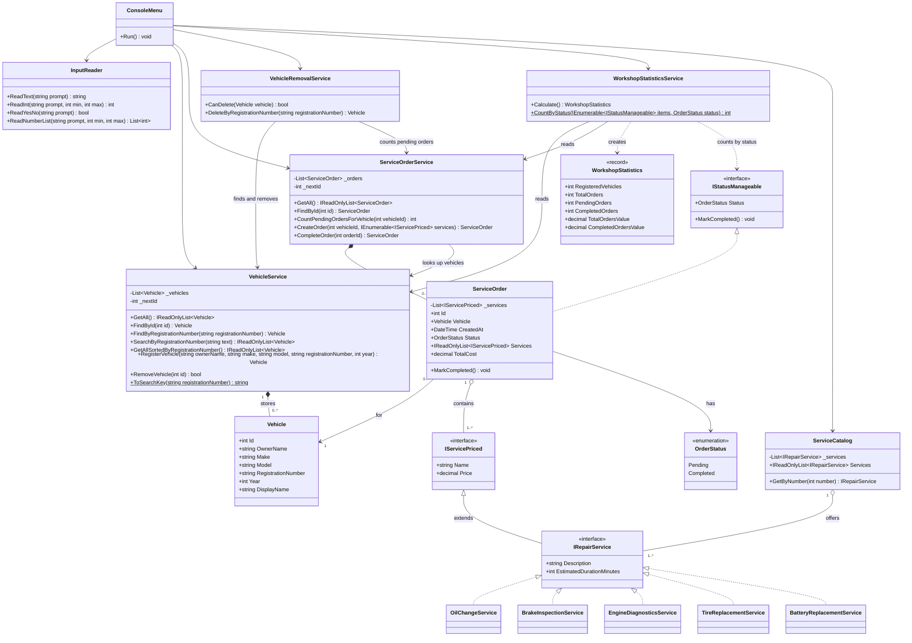

# UML Class Diagram — Car Service Center Management System

This diagram shows the final implementation of the project. Every class, interface and member shown here exists in the source code under `CarServiceCenter/`. The same diagram is included in `README.md`, section 9.

## How to read the diagram

| Notation | Meaning in this project |
|---|---|
| `<\|--` (solid line, hollow triangle) | Interface inheritance: `IRepairService` extends `IServicePriced`. |
| `<\|..` (dashed line, hollow triangle) | Realization: a class implements an interface (e.g. `OilChangeService` implements `IRepairService`, `ServiceOrder` implements `IStatusManageable`). |
| `o--` (hollow diamond) | Aggregation: a `ServiceOrder` contains 1..* services and the `ServiceCatalog` offers 1..* services, but the service objects are created elsewhere (in `Program.cs`). |
| `*--` (filled diamond) | Composition: `VehicleService` owns its list of vehicles and `ServiceOrderService` owns its list of orders. |
| `-->` (solid arrow) | Association: the class keeps a reference to the other one (usually a constructor dependency). |
| `..>` (dashed arrow) | Dependency: the class only uses the other type temporarily (creates it or receives it as a parameter). |
| `$` after a method | Static method (`CountByStatus`, `ToSearchKey`). |

## Most important relationships

1. **`ServiceOrder "1" o-- "1..*" IServicePriced`.** An order holds one or more services, but it only knows them through the small `IServicePriced` interface. This is why `TotalCost` works for any present or future service (OCP) and why the order does not depend on catalog data it does not use (ISP).
2. **The five `IRepairService` implementations.** All concrete services implement the same abstraction. Adding a new service means adding a new class here, with no change to `ServiceOrder` or `ServiceOrderService`.
3. **`IStatusManageable <|.. ServiceOrder`.** Only orders have a status. Repair services do not implement this interface, so they are not forced to provide a `MarkCompleted()` method they would never use.
4. **`VehicleRemovalService` → `VehicleService` and `ServiceOrderService`.** Deleting a vehicle needs both: it may be removed only if it has no Pending orders. Putting this rule in its own class avoids a circular dependency (`ServiceOrderService` already depends on `VehicleService`) and keeps the rule out of the UI (SRP). Completed orders keep their reference to the deleted `Vehicle`, so service history is preserved.
5. **The `ConsoleMenu` arrows.** The UI depends on the business services, never the other way round. The services have no `Console` calls, which keeps responsibilities separate (SRP).
